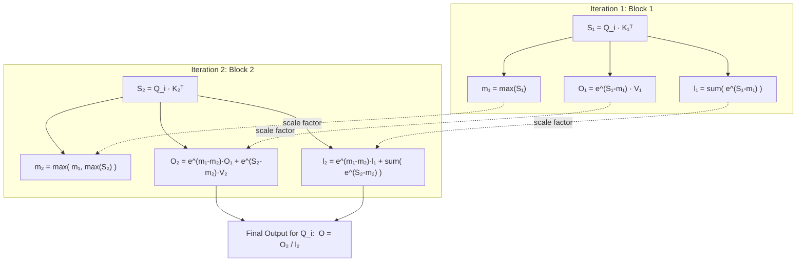

# What is Flash Attention?

Flash Attention is a groundbreaking algorithm introduced in 2022 that mathematically computes standard Transformer attention, but does so **significantly faster and with much less memory**.

To understand why it is such a big deal, we first have to understand the bottleneck in standard attention.

## The Problem: Standard Attention is Memory-Bound

In standard self-attention, the model has to compute the relationship (attention score) between every single token in a sequence and every other token. 

Mathematically, it looks like this:
`Attention(Q, K, V) = softmax(Q * K^T) * V`

If your sequence length ($N$) is 1,000 tokens, the matrix `Q * K^T` is $1,000 \times 1,000$ (1 million elements). If your sequence length increases to 10,000 tokens, the matrix becomes $10,000 \times 10,000$ (100 million elements). **The memory required grows quadratically ($O(N^2)$).**

But the real bottleneck isn't the math; it's the **hardware**. 

GPUs have two main types of memory:
1. **HBM (High Bandwidth Memory / VRAM):** Very large (e.g., 24GB - 80GB), but relatively slow to read from and write to.
2. **SRAM (Static RAM):** Extremely tiny (e.g., 20MB - 40MB), but lightning fast.

In standard attention, PyTorch does the following:
1. Reads Q and K from HBM.
2. Computes `Q * K^T` and **writes the massive $N \times N$ matrix to HBM**.
3. Reads the massive matrix back from HBM to apply `softmax`.
4. **Writes the softmax matrix back to HBM.**
5. Reads the softmax matrix and V from HBM to compute the final output.

All this reading and writing to the slow HBM is what makes Transformers slow and memory-hungry. We call this being **"Memory-Bound"**.

## The Solution: Flash Attention (Tiling and Fusion)

Flash Attention realizes that writing that massive $N \times N$ matrix to HBM is completely unnecessary. 

Instead of doing the math across the entire sequence all at once, Flash Attention breaks the matrices into smaller blocks (or **"tiles"**) that fit perfectly inside the ultra-fast **SRAM**.

1. It loads a small block of Q, K, and V into the tiny, fast SRAM.
2. It computes the attention scores for just that block.
3. It applies the softmax for just that block (using clever math to keep track of the running maximums and sums).
4. It multiplies by V for just that block.
5. It writes the *final, small output* back to HBM.

Because the massive intermediate $N \times N$ matrix is never actually materialized and written to the slow HBM, Flash Attention requires exponentially less memory and runs **2x to 4x faster**.

### The "Online Softmax Trick" Explained

The biggest hurdle in tiling attention is the **Softmax** function. Standard softmax requires you to know the sum of *all* elements in a row before you can compute the final probability of any single element. How can we do this if we only load small blocks of Keys and Values at a time?

The solution is the **Online Softmax trick**. Instead of computing the final softmax immediately, we keep track of two running variables as we iterate through the Key/Value blocks:
1. `m`: The running maximum value seen so far.
2. `l`: The running sum of the exponentials.

When we process a new block, if we find a new maximum value, we mathematically "scale down" our previous running sums and partial outputs by the difference between the old max and the new max (`exp(m_old - m_new)`). This ensures everything stays mathematically identical to as if we computed it all at once!



## How we implemented it in AIMathLab

In PyTorch 2.0 and above, Flash Attention is built directly into the framework via the `torch.nn.functional.scaled_dot_product_attention` function.

By passing `is_causal=True`, the function also automatically handles the lower-triangular masking directly in optimized C++, which means we can completely remove our custom `tril` mask buffer!

You can toggle it in this repository by setting `use_flash_attention = True` in the `ModelConfig`.

### The Code: Before vs After

Here is exactly how the `forward` pass changes in our code.

**Before (Classic Attention) via `_forward_classic`:**
We have to manually calculate affinities, mask the future tokens, apply softmax, and aggregate values.
```python
# 1. Compute attention scores ("affinities")
wei = q @ k.transpose(-2, -1) * k.shape[-1]**-0.5

# 2. Apply causal mask (so the model can't look ahead)
wei = wei.masked_fill(self.tril[:T, :T] == 0, float('-inf')) 

# 3. Softmax
wei = F.softmax(wei, dim=-1)
wei = self.dropout(wei)

# 4. Perform the weighted aggregation of the values
out = wei @ v
```

**After (Flash Attention) via `_forward_flash_educational`:**
Instead of doing it all at once, we tile the operation into blocks (e.g. $32 \times 32$) and use the "Online Softmax Trick" to dynamically keep track of the max and sum denominators.

```python
# Tile sizes (blocks to load into "SRAM")
Br = 32
Bc = 32

# Outer loop: Query blocks
for i in range(0, T, Br):
    q_i = q[:, :, i:i+Br, :]
    
    # Inner loop: Key/Value blocks
    for j in range(0, T, Bc):
        k_j = k[:, :, j:j+Bc, :]
        v_j = v[:, :, j:j+Bc, :]

        # 1. Compute block-wise affinities
        S_ij = q_i @ k_j.transpose(-2, -1) / (d ** 0.5)

        # 2. Online Softmax Trick (keep running maximums and sums)
        # ... (math to update running max 'm' and sum 'l') ...

        # 3. Multiply by V and accumulate output
        # ... (update running output 'O') ...

# 4. Divide output by running sum to normalize
y = O / l
```

> [!TIP]
> **Production vs Educational**
> 
> The code above is implemented from scratch in pure Python in the `_forward_flash_educational` method so you can read and understand the math line-by-line! 
> 
> However, because Python is slow, running this loop manually defeats the performance benefits of Flash Attention. In practice, PyTorch implements this **exact same math** via a highly optimized, fused C++ kernel. 
> 
> Therefore, for actual training, we just call PyTorch's optimized function directly in our `_forward_flash` method:
> ```python
> out = F.scaled_dot_product_attention(
>     q, k, v, 
>     attn_mask=None, 
>     dropout_p=self.dropout_val if self.training else 0.0, 
>     is_causal=True
> )
> ```
