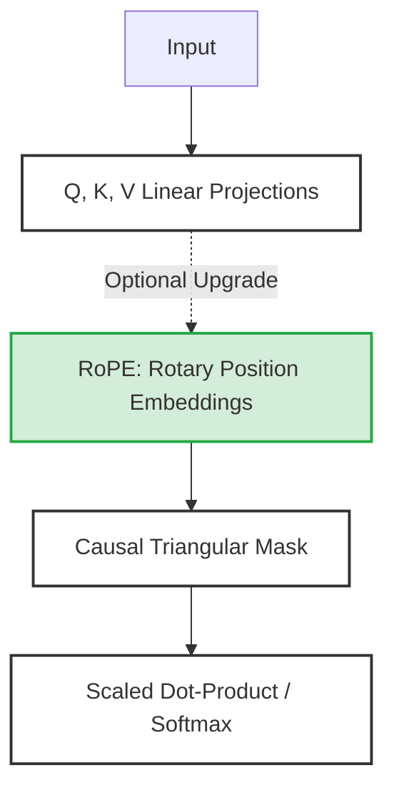
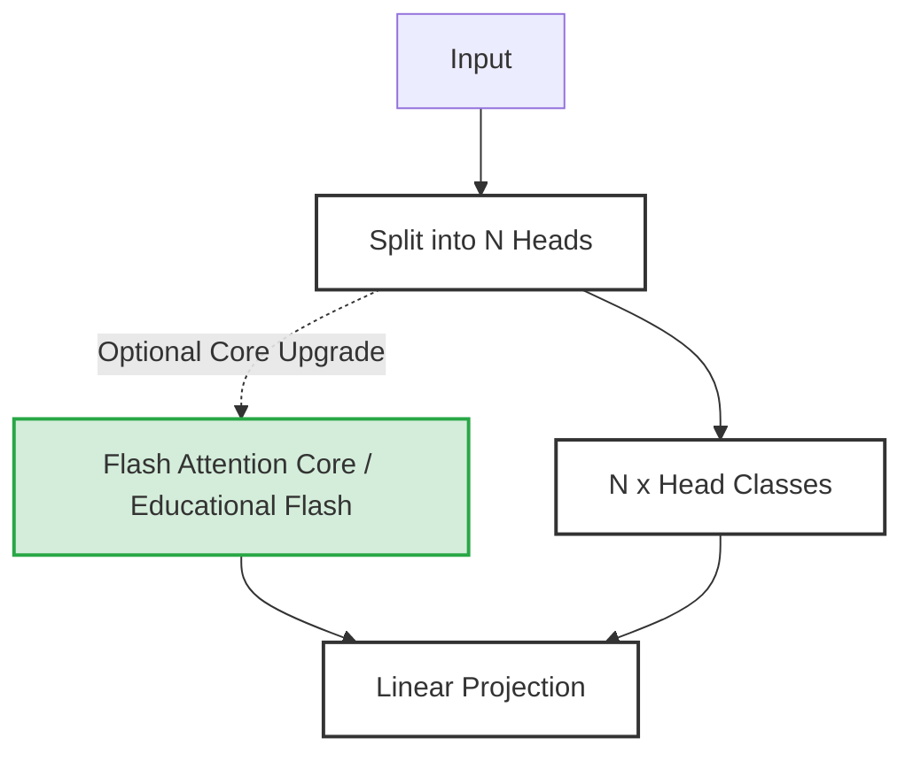
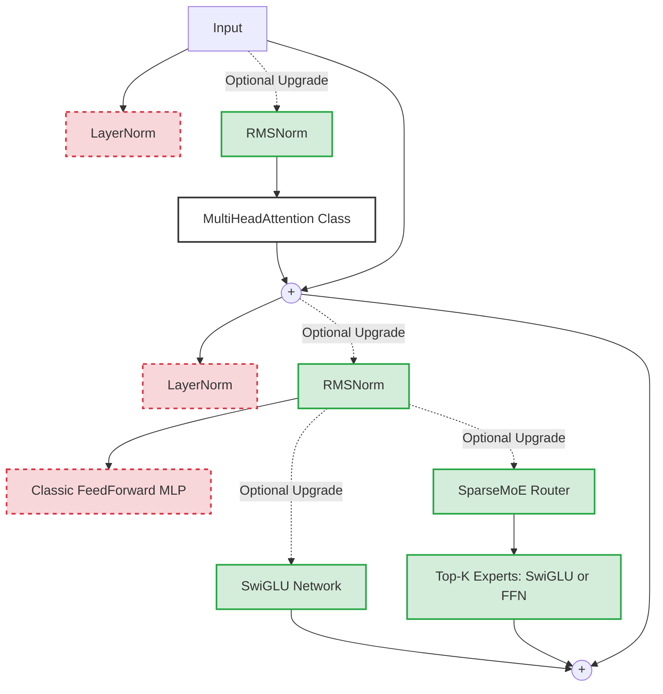
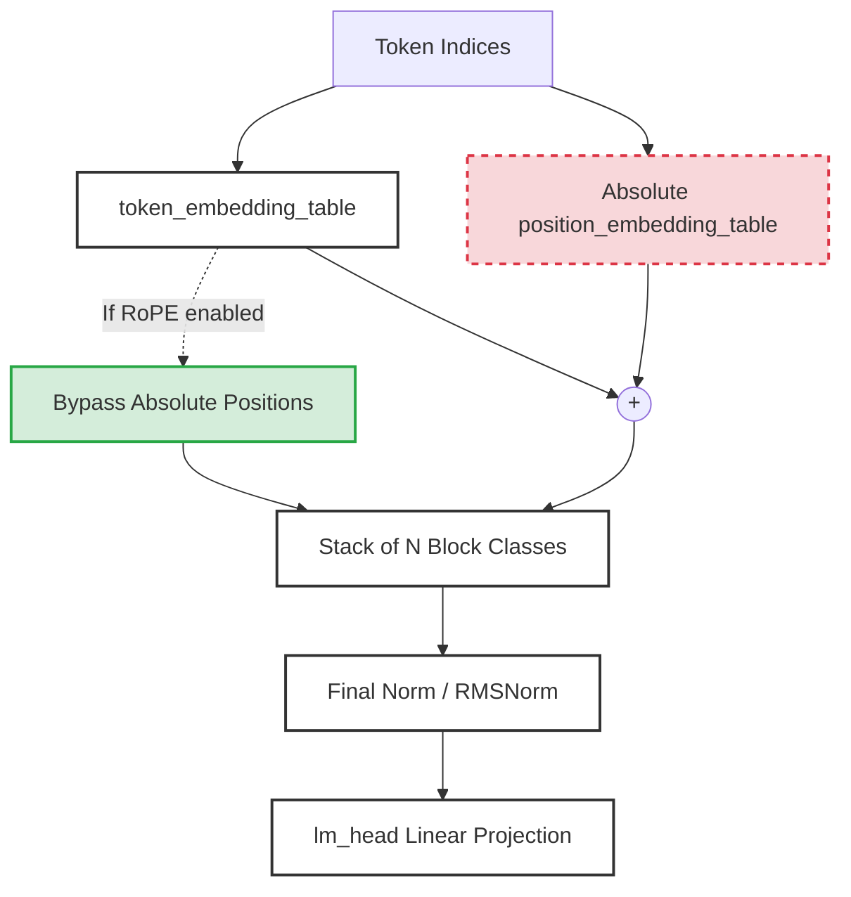

# Mini-GPT Math Alignment Experiment

This repository contains a custom implementation of a Decoder-Only Transformer (Mini-GPT) built from scratch in PyTorch, designed specifically for running experiments on Apple Silicon (MPS). 

The primary goal of this project is to explore how small language models learn mathematical reasoning through pretraining on English text and alignment on structured Chain-of-Thought math datasets.

## Project Structure

*   `model.py`: The core Transformer architecture (Self-Attention Blocks, FeedForward layers, custom token generation).
*   `data_loader.py`: Handles tokenization and batching. Contains `WikiTextDataset` for English pretraining and `SyntheticMathDataset` for math alignment.
*   `train.py`: The main training loop. Handles optimization, logging, and switching between pretraining and alignment phases.
*   `generate_math_data.py`: A script that procedurally generates mathematical word problems (+, -, *, /) using a Chain-of-Thought "scratchpad" technique to prevent dataset leakage and improve model reasoning.
*   `create_balanced_eval.py`: Extracts a perfectly balanced subset of mathematical operations for evaluation.
*   `evaluate.py`: Tests the model's true arithmetic accuracy by prompting it to generate answers autoregressively and parsing the output.

## Model Architecture

The `Mini-GPT` is configured with the following default parameters (which can be tweaked in `model.py`):
*   **Vocabulary Size**: 50,257 (GPT-2 standard)
*   **Transformer Blocks (Layers)**: 6
*   **Attention Heads**: 6
*   **Embedding Dimension**: 384
*   **Context Length (Timesteps)**: 256 tokens

### Hierarchical Architecture Breakdown
While the code started as a classic GPT-2 replica, it has been heavily modernized to match the architectural standards of today's state-of-the-art models (like LLaMA 3, Mistral, and GPT-4).

Instead of a single massive diagram, let's break down the architecture from the bottom-up, exploring how each class is built and exactly where the modern optimizations fit in.

#### 1. `Head` Class (Single Attention Head)
The smallest building block. It takes a sequence of embeddings and computes their mutual "affinities" (attention scores).



#### 2. `MultiHeadAttention` Class
Groups multiple `Head` classes together so the model can pay attention to different concepts simultaneously, or bypasses them entirely for a highly optimized core.



#### 3. `Block` Class (Transformer Layer)
The core loop. It combines "communication" (Attention) with "computation" (FeedForward), wrapped in normalization and residual connections.



#### 4. `GPT` Class (Full Model)
The outer wrapper that manages embeddings, stacks the `Block` classes, and projects the final output back into vocabulary logits.



#### The Upgrades Breakdown:
1. **[Flash Attention](file:///Users/sourabhk/Workspace/ExperimentingData/Training/model.py):** Modifies `MultiHeadAttention` to bypass the slow, explicit `Head` loops and compute attention matrices in ultra-fast, SRAM-aware chunks.
2. **[SwiGLU](file:///Users/sourabhk/Workspace/ExperimentingData/Training/model.py):** Replaced the classic `FeedForward` MLP inside `Block`. It uses a dual-pathway gating mechanism with a Swish activation, giving the model an internal "if/else" mechanism that massively improves arithmetic and conditional reasoning.
3. **[RMSNorm](file:///Users/sourabhk/Workspace/ExperimentingData/Training/model.py):** Conditionally swaps `nn.LayerNorm` inside `Block` and `GPT`. By dropping the computationally expensive mean-centering step, it speeds up the network without sacrificing stability.
4. **[RoPE (Rotary Position Embeddings)](file:///Users/sourabhk/Workspace/ExperimentingData/Training/model.py):** We conditionally bypass the `position_embedding_table` at the start of `GPT`. Instead, positional information is mathematically injected directly into the Query and Key vectors inside `Head` and `MultiHeadAttention`. Because the Attention block uses a dot product (measuring angles), this rotation perfectly encodes the *relative* distance between tokens, no matter how deep the network gets.
5. **[SparseMoE (Mixture of Experts)](file:///Users/sourabhk/Workspace/ExperimentingData/Training/model.py):** Conditionally replaces the single FeedForward or SwiGLU network with a dynamic routing layer. It creates N experts (which can themselves be SwiGLU networks) and selectively routes each token to the best K experts, massively expanding model capacity without increasing compute time per token.

## Mathematical Reasoning & Chain-of-Thought

Because Transformers have a fixed depth, they possess a hard limit on the amount of computation they can perform in a single forward pass. To enable the model to solve complex arithmetic, we generate our math datasets with explicit `<thought>` tags. 

By forcing the model to generate a step-by-step scratchpad, we effectively give the model a recurrent "memory" state. This allows a shallow model to execute deep algorithmic reasoning by looping its forward passes over many tokens before arriving at the final answer.

### Edge Devices & Embedded Systems

This Chain-of-Thought approach is highly applicable to **embedded systems, smartphones, and robotics**. These devices are severely memory-constrained and cannot host massive 7-Billion parameter models. 

By utilizing tiny models (like this 124M parameter Mini-GPT) combined with Chain-of-Thought prompting, we can **trade inference latency for computational depth**. The edge device spends more time generating step-by-step tokens, allowing a tiny, memory-efficient model to punch far above its weight class and solve complex problems locally. For example, instead of forcing the model to instantly memorize `123 + 456 = 579`, the dataset trains the model to break the problem down:
`Q: What is 123 + 456?`
`A: <thought> 123 + 456 = 100 + 400 + 20 + 50 + 3 + 6 = 500 + 70 + 9 = 579 </thought> 579`

This "unrolls" the computation over time, giving the model significantly more compute per problem.

## Data Generation

To regenerate the synthetic datasets (100,000 train samples, 5,000 eval samples):
```bash
python generate_math_data.py
```
This ensures zero overlap between the training and evaluation sets.

## The Massive Grid Search Experiment

This repository comes with an automated experiment script to measure the exact point at which a language model "learns" to do math.

The experiment runs a 2-dimensional grid search:
1.  **WikiText Pretraining Steps**: It tests models pretrained for `[100, 5000, 10000, 15000, 20000]` steps to see if a better grasp of language helps the model learn math faster.
2.  **Math Alignment Steps**: For each pretrained model, it continually trains on the Chain-of-Thought math dataset, stopping to evaluate its true accuracy every 1,000 steps up to 5,000 steps.

### Running the Experiment

To kick off the automated experiment:
```bash
python experiment.py
```

All results are logged live to a CSV file (`experiment_results.csv`), including elapsed time, overall accuracy, and accuracy broken down by operation.

To monitor the model getting smarter in real-time, open a separate terminal and run:
```bash
tail -f experiment_results.csv
```

## Standalone Evaluation

If you just want to evaluate an existing `model.pt` weights file without running the full experiment:
```bash
python create_balanced_eval.py
python evaluate.py
```
